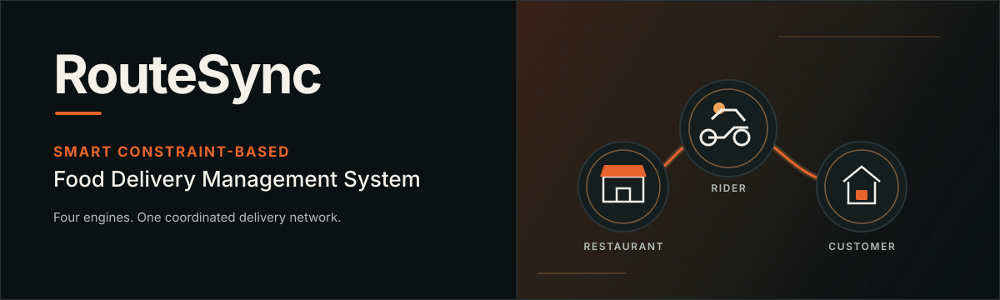
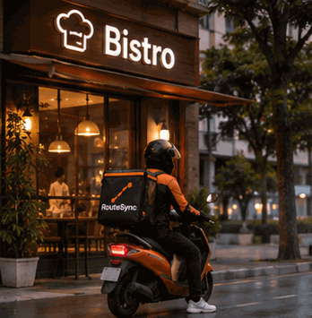
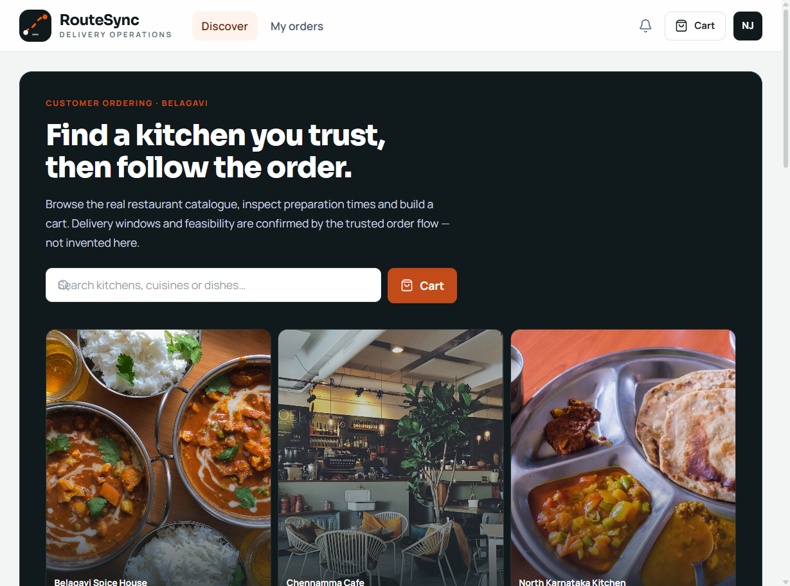
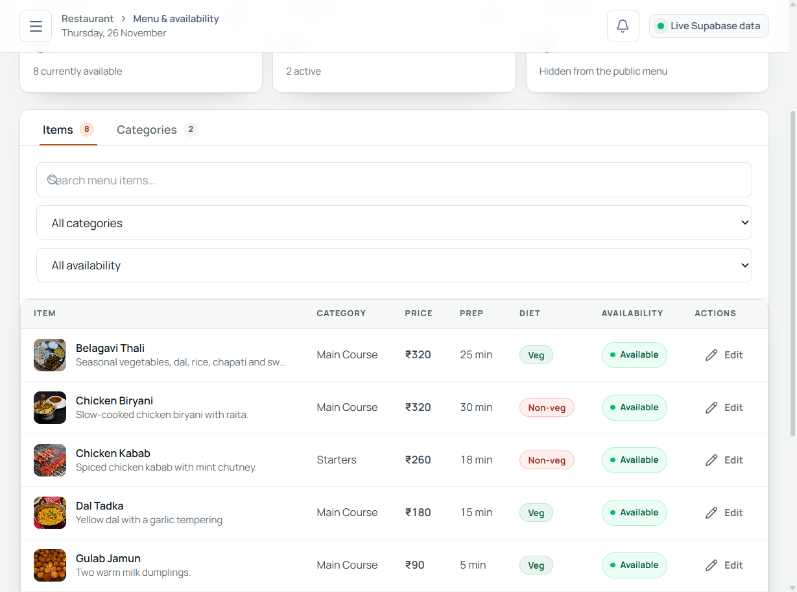
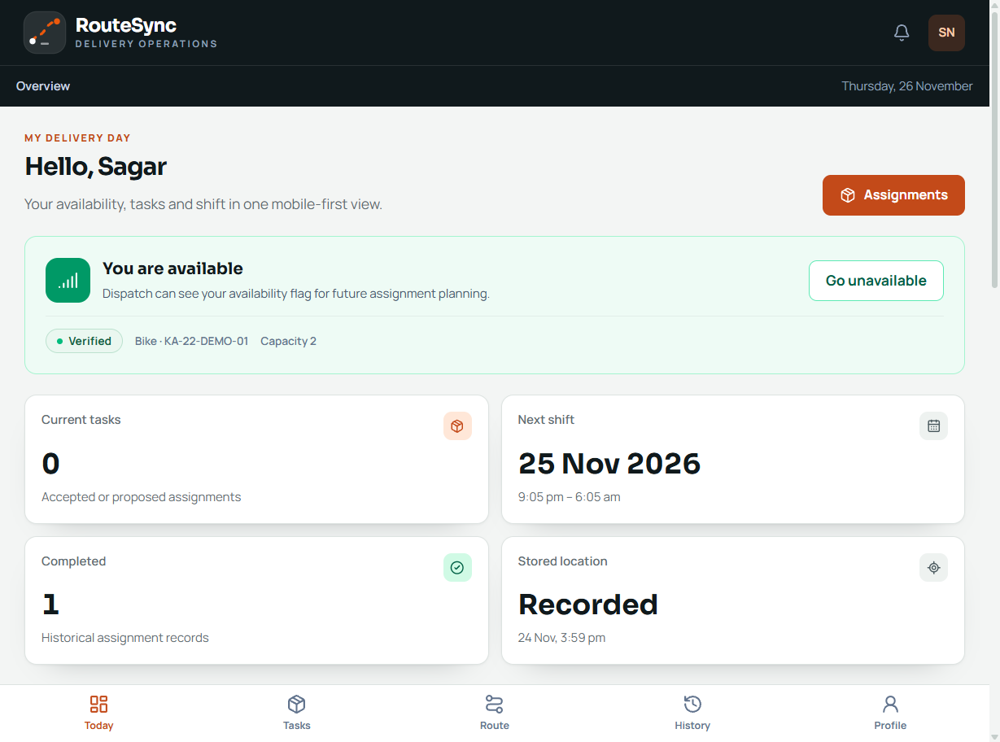
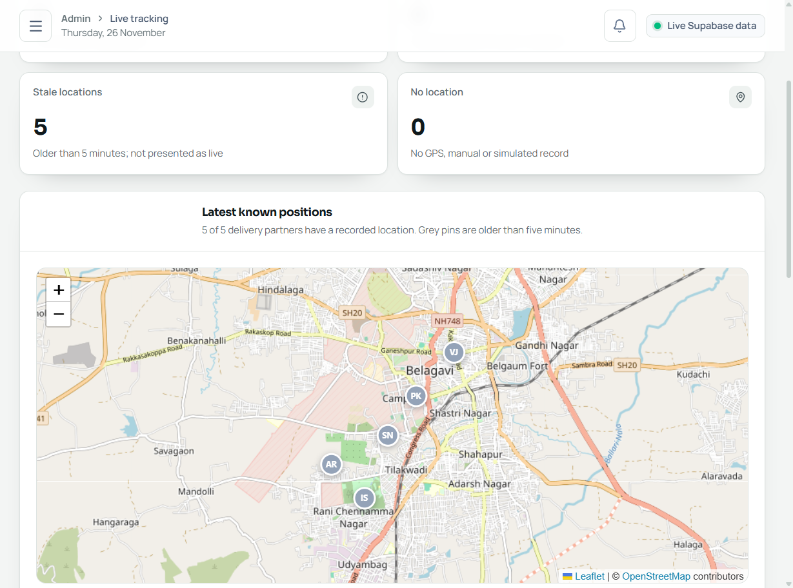
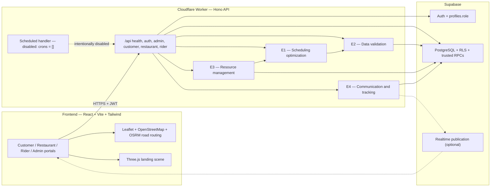
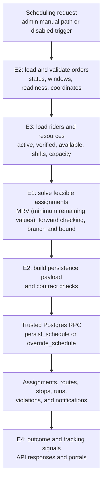
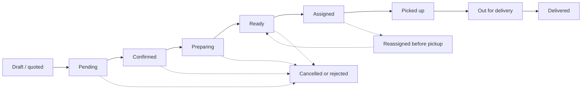
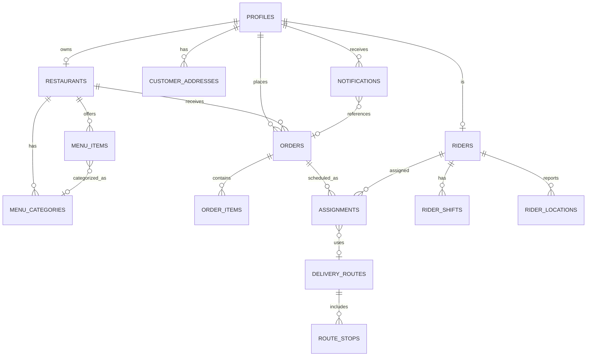

<div align="center">
  

  <p>
    <a href="https://routesync.vijapurnikhil61.workers.dev"></a>
    <a href="https://github.com/Nikhil306-ctrl/RouteSync/actions/workflows/ci.yml"></a>
    
    
    
    
  </p>
</div>

<div align="center">
  
  <p><em>Illustrated cinematic delivery journey — not application footage.</em></p>
</div>

---

## Overview

RouteSync is an academic food-delivery operations platform that coordinates restaurants, riders, customers, and administrators through **four role-specific portals** and **four cooperating engines**. It models delivery coordination as a constraint-first problem: order eligibility, preparation windows, rider shifts, capacity, route feasibility, and trusted state transitions are checked before assignments are persisted.

The repository contains a React + Vite frontend, a Hono API deployed on Cloudflare Workers with static asset hosting, and a Supabase backend using PostgreSQL, Auth, Row Level Security, RPCs, and optional Realtime publication.

> **Academic demonstration status:** RouteSync is a working prototype, not a production-ready commercial platform. Some advanced live verification remains incomplete; see [Known limitations](#known-limitations).

### Problem → approach → outcome

| Problem | RouteSync approach | Outcome |
|---|---|---|
| Delivery state can drift across customer, restaurant, rider, and admin views. | Trusted server-side lifecycle transitions with history and role-scoped reads. | Auditable order history and consistent portal state. |
| Manual dispatch ignores time windows, shifts, capacity, and geography. | E1–E4 constraint solving with bounded search and trusted persistence. | Feasible rider assignments and route plans under explicit constraints. |
| Browser clients must not bypass operational rules. | Supabase Auth, RLS, and service-role RPCs for protected writes. | Role-gated workflows with server-side enforcement. |
| Customers and riders need timely operational signals. | E4 communication and tracking with notifications and polling fallback. | Shared progress across four portals. |

---

## Contents

[Portals](#portal-showcase) · [Capabilities](#core-capabilities) · [Architecture](#four-engine-architecture) · [Scheduling](#constraint-based-scheduling-and-optimization) · [Lifecycle](#order-lifecycle) · [Database](#database-architecture)

[Stack](#technology-stack) · [API](#api-overview) · [Install](#local-installation) · [Deploy](#deployment) · [Security](#security-and-authentication) · [Tests](#testing-and-verification)

[Limitations](#known-limitations) · [Roadmap](#roadmap) · [Team](#academic-team-and-contributions) · [Docs](#documentation-index)

---

## Portal showcase

Screenshots are genuine portal captures supplied in the repository. Routes are shown at a high level; actual access is enforced by Supabase Auth, trusted profile roles, and RLS.

<table>
  <tr>
    <td align="center" width="50%" valign="top">
      <strong>Customer portal</strong><br />
      
      <br /><small>Browse, order, and track.</small>
    </td>
    <td align="center" width="50%" valign="top">
      <strong>Restaurant portal</strong><br />
      
      <br /><small>Menu and preparation flow.</small>
    </td>
  </tr>
  <tr>
    <td align="center" width="50%" valign="top">
      <strong>Rider / delivery partner portal</strong><br />
      
      <br /><small>Assignments, route, and history.</small>
    </td>
    <td align="center" width="50%" valign="top">
      <strong>Admin dispatch portal</strong><br />
      
      <br /><small>Scheduling, oversight, and tracking.</small>
    </td>
  </tr>
</table>

| Portal | Route family | Implemented capabilities |
|---|---|---|
| Customer | `/customer/*`, checkout and tracking flows | Browse restaurants and menus, cart and checkout, place orders, view order history and tracking, manage profile, addresses, and notifications. |
| Restaurant | `/restaurant/*` | Dashboard, menu, profile, and preparation workflow through trusted APIs/RPCs. |
| Rider / Delivery Partner | `/delivery-partner/*` with `/delivery` redirect | Assignments, route, history, shifts, profile, and availability/location updates through trusted endpoints. |
| Admin | `/admin/*` | Dispatch, scheduling, orders, restaurants, riders, live tracking, rescheduling, violations, and audit-oriented views. |

Roles are resolved from trusted `profiles.role` data after Supabase Auth sign-in. Client-supplied metadata is not trusted for authorization.

---

## Core capabilities

- **Constraint-first scheduling** — validated order batches, bounded rider search, precedence-preserving stop sequences, and trusted persistence.
- **Geographic planning** — Haversine distance over a complete estimated graph with Dijkstra shortest-path search; OSRM road routes and Leaflet display in the frontend.
- **Trusted order lifecycle** — protected RPCs for quote, create, transition, assign, and respond flows, with status-event and assignment-event history.
- **Role-scoped security** — Supabase Auth, RLS, least-privilege grants, and service-role-only write paths for sensitive operations.
- **Four-portal operations** — customer ordering, restaurant preparation, rider assignment, and admin dispatch in one system.
- **Communication and tracking** — notifications, assignment events, rider location reporting, customer-facing tracking, and capped polling fallback.
- **Operational diagnostics** — health probe, scheduling metrics, rejection reasons, constraint violations, and audit-oriented records.
- **Interactive landing page** — React, Tailwind CSS, and a Three.js delivery scene with a persistent scooter asset.

---

## Four-engine architecture



### Engine responsibilities

| Engine | Academic owner | Responsibility |
|---|---|---|
| **E1 — Smart Scheduling & Optimization** | Nikhita Rajesh Patil | Constraint search, route sequencing, weighted scoring, and bounded optimization. |
| **E2 — Data & Validation** | Nikhil Vijapur | Order eligibility, timing/coordinate checks, persistence contracts, and validation rejections. |
| **E3 — Resource Management** | Sakshi Magadum | Rider availability, verification, shifts, capacity, and resource state. |
| **E4 — Communication & Tracking** | Ritvik Shinde | Notifications, assignment events, tracking signals, and cross-portal updates. |

### Scheduling flow



---

## Constraint-based scheduling and optimization

E1 models scheduling as a constraint-satisfaction problem. Orders are variables, feasible rider/route placements are domains, and hard constraints are evaluated before weighted scoring.

### Algorithm highlights

- **Bounded search** — configurable limits for search nodes, execution time, and candidate evaluation.
- **Greedy incumbent** — retains a useful feasible assignment set when the search is bounded.
- **MRV and forward checking** — orders with the fewest feasible placements are considered first.
- **Branch and bound** — prunes branches that cannot improve the current assignment count/cost.
- **Batch limit** — at most three orders per rider batch in the current implementation.
- **Route sequencing** — precedence-preserving pickup/dropoff sequences with deadline and shift checks.
- **Weighted scoring** — approach distance, route distance, completion time, deadline slack, rider workload, and detour cost.
- **Geographic estimate** — complete Haversine graph, Dijkstra shortest paths, provisional `18 km/h` speed, and two minutes per stop.
- **Frontend road routing** — public OSRM demo server with a geographic fallback; not a guarantee of live traffic-aware routing.

### Hard constraints

Hard constraints are enforced in application logic and/or database RPCs as implemented:

- role and authorization checks;
- eligible order status, preparation readiness, and delivery window;
- valid pickup/dropoff coordinates and addresses;
- rider active, verified, and available state;
- valid current shift coverage for planned pickup and delivery;
- rider concurrency and capacity limits;
- no silent rewrite of existing committed routes;
- batch compatibility and detour limits;
- idempotency and duplicate-assignment protections;
- route/assignment consistency checks in SQL.

Exact behavior is defined in `backend/src/engines/*`, `backend/src/lib/scheduling*.js`, and `supabase/migrations/*`.

---

## Order lifecycle

Order transitions are handled through trusted server-side flows in `backend/src/lib/orderLifecycle.js` and the lifecycle migration. The system records status events, assignment events, notifications, and scheduling effects.



### Operational sequence

1. **Customer order placed** — the order enters the trusted lifecycle.
2. **Restaurant preparation** — the kitchen confirms the preparation window.
3. **Constraint-based scheduling** — E1–E4 solve feasible assignments.
4. **Rider assignment** — the assignment is committed through a trusted RPC.
5. **Delivery tracking** — live position is shared with the customer.
6. **Completed delivery** — the order state closes with history retained.

- Browser roles cannot directly write protected order status rows.
- Assignment responses revalidate rider state, shift coverage, and capacity on acceptance.
- Reassignment before pickup restores the order to `ready` and preserves history.
- Late deliveries remain recordable after pickup; the lifecycle does not block them solely on the planned deadline.
- See `docs/PHASE5_ORDER_LIFECYCLE.md` for the operator runbook and verification SQL.

---

## Database architecture

Migrations under `supabase/migrations/` define enums, core tables, operations tables, functions, triggers, RLS policies, and grants. Realtime is an optional enhancement; capped polling remains the required fallback.



Nullable foreign keys are shown as zero-or-one relationships. `assignments.route_id` is nullable and non-unique, so a shared route can group zero or more assignments; a route stop always belongs to one route and may carry an optional assignment reference.

Key domains:

- **Identity/profile:** `profiles`, `riders`, `rider_shifts`
- **Restaurant/menu:** `restaurants`, `menu_categories`, `menu_items`
- **Customers:** `customer_addresses`
- **Orders:** `orders`, `order_items`, `order_status_events`
- **Fulfillment:** `assignments`, `assignment_events`, `delivery_routes`, `route_stops`, `rider_locations`, `scheduling_runs`, `constraint_violations`
- **Messaging/audit:** `notifications`, `audit_logs`

For exact columns, constraints, and policies, refer to the SQL migration files and `docs/PHASE3_DATABASE_AUTH.md`.

---

## Technology stack

| Layer | Technologies |
|---|---|
| Frontend | React 19, React Router 7, Vite 7, Tailwind CSS via `@tailwindcss/vite`, Supabase JS client |
| Visualization | Three.js landing scene, Leaflet, OpenStreetMap tiles, OSRM demo routing |
| API | Hono on Cloudflare Workers, static asset hosting, role-scoped `/api/*` routes |
| Database | Supabase PostgreSQL, Auth, RLS, trusted RPCs, optional Realtime publication |
| Scheduling | Constraint satisfaction, bounded backtracking, MRV, forward checking, branch and bound, Dijkstra geographic routing |
| Tooling | Node.js `>=22.12.0`, npm scripts, GitHub Actions CI |

---

## API overview

API routes are mounted under `/api` in `backend/src/app.js` and `backend/src/routes/*`.

| Group | Purpose |
|---|---|
| `GET /api/health` | Worker/runtime and Supabase connectivity probe; returns safe failures without leaking secrets. |
| `/api/auth/*` | Authentication-related endpoints. |
| `/api/admin/*` | Admin dispatch, scheduling, orders, riders, tracking, and oversight. |
| `/api/customer/*` | Customer-facing ordering, addresses, and tracking operations. |
| `/api/restaurant/*` | Restaurant menu, preparation, and order operations. |
| `/api/rider/*` | Rider assignment, availability, location, and history operations. |

Exact request/response shapes are defined in the route handlers and shared helpers under `backend/src/lib/*`.

---

## Local installation

### Prerequisites

- Node.js `>=22.12.0`
- npm
- A Supabase project with migrations applied for full workflow testing

### Install

```powershell
git clone https://github.com/Nikhil306-ctrl/RouteSync.git
cd RouteSync
npm run install:all
```

### Configure environment

Create local ignored environment files using placeholders only:

| File | Variables |
|---|---|
| `frontend/.env.local` | `VITE_SUPABASE_URL`, `VITE_SUPABASE_PUBLISHABLE_KEY` |
| `backend/.dev.vars` | `SUPABASE_URL`, `SUPABASE_PUBLISHABLE_KEY`, `SUPABASE_SECRET_KEY` |
| Worker `CORS_ORIGIN` | Comma-separated allowed origins; configured for the live demo and `http://localhost:5173` |

Templates: `frontend/.env.local.example`, `backend/.dev.vars.example`, and `.env.example`.

The Worker secret key is server/CLI-only. Never place it in frontend environment variables or commit it. Demo seed variables are development-only; follow [tests/README.md](tests/README.md) and [docs/PHASE3_DATABASE_AUTH.md](docs/PHASE3_DATABASE_AUTH.md).

### Prepare Supabase

Apply migrations in order to the intended project. The order lifecycle runbook is in [docs/PHASE5_ORDER_LIFECYCLE.md](docs/PHASE5_ORDER_LIFECYCLE.md); database/auth setup is in [docs/PHASE3_DATABASE_AUTH.md](docs/PHASE3_DATABASE_AUTH.md).

### Start application

```powershell
npm run dev
```

Typical local URLs:

- Frontend: `http://localhost:5173`
- Worker/API: `http://localhost:8787`

Run processes separately when needed:

```powershell
npm run dev:worker
npm run dev:frontend
```

---

## Deployment

The live demo is deployed at `https://routesync.vijapurnikhil61.workers.dev`.

After building and validating locally:

```powershell
npm run build
npx wrangler login
npm run worker:deploy
npm run worker:tail
```

Set Worker secrets from `backend/` with `wrangler secret put <NAME>`:

- `SUPABASE_URL`
- `SUPABASE_PUBLISHABLE_KEY`
- `SUPABASE_SECRET_KEY`

The current `backend/wrangler.jsonc` intentionally sets `"triggers": { "crons": [] }`. Automatic scheduling is disabled pending persistence reliability investigation; manual/admin scheduling remains the supported path.

---

## Security and authentication

- Supabase Auth issues the user session; trusted `profiles.role` data drives authorization.
- RLS and least-privilege grants scope reads and protect application tables.
- Sensitive lifecycle and scheduling writes go through service-role RPCs.
- Session recovery uses a bounded, single-flight refresh with same-user guards and invalid-session listeners; the dedicated regression suite passes locally.
- Production verification of the session-recovery behavior remains pending.
- Browser clients use publishable keys only; `SUPABASE_SECRET_KEY` is server/CLI-only.
- Never commit `.env`, `backend/.dev.vars`, private keys, auth session exports, or rotated secrets.

If a secret is exposed, rotate it immediately in the provider dashboard and update local/secret stores; do not commit the new value.

---

## Testing and verification

```powershell
npm run test:local
npm run test:auth
npm run build
```

| Check | Result |
|---|---|
| `npm run test:local` | **116/116 passed** |
| Auth session recovery suite | **11/11 passed**; included in the 116 local tests |
| `npm run build` | **Passed** with the existing Vite chunk-size advisory |
| Cloudflare Worker deployment | **Successful** (`routesync`, version `877dba59-3773-46fa-b950-34fd9779227e`) |
| Production smoke checks | **Passed** for `/api/health`, CORS, and SPA fallback |
| Remote auth suite | Optional, environment-dependent; not part of default CI |
| Full live production verification | **Not complete**; see limitations |

Local tests are static/unit tests and source assertions. They do not connect to PostgreSQL or verify every feature in production. Controlled diagnostics have demonstrated isolated scheduling persistence and related readback/cancellation/capacity behaviors, but advanced live verification is not certified in this repository state.

---

## Known limitations

- **Scheduling cron is intentionally disabled** in `backend/wrangler.jsonc` while persistence reliability is investigated.
- **`persist_schedule` can intermittently time out** under some conditions. Reconciliation may be required; a timed-out client call does not prove that nothing was committed. Check database state before retrying destructive steps.
- **Session recovery is regression-tested locally** but still needs production verification.
- **Complete mobile workflow verification remains pending** across the customer, restaurant, rider, and admin portals.
- **Public routing is approximate.** The frontend uses the public OSRM demo server with geographic fallback; E1 uses Haversine estimates rather than a verified road network or live traffic model.
- **Payments are cash on delivery**; no online payment integration is implemented.
- **Realtime is optional**; capped polling is the required fallback.
- **Academic prototype scope:** not hardened for production SLAs, incident response, observability, or commercial deployment.
- **Not every feature has independent production verification.** Evidence is limited to local tests, static checks, controlled diagnostics, and the deployed demo.

---

## Roadmap

These items are proposed work, not completed features:

| Proposed area | Direction |
|---|---|
| Scheduling reliability | Resolve `persist_schedule` timeout root cause and reconsider a safe cron trigger. |
| Batch economics | Multi-order batching incentives and smarter grouping. |
| Pricing | Dynamic delivery pricing based on distance, windows, and capacity. |
| Restaurant analytics | Profitability and operational reporting. |
| Retention | Coupons and loyalty flows. |
| Payments | Integrations beyond cash on delivery. |
| Scale | Improved scheduling reliability and scalability under larger order volumes. |
| Visualization | Enhanced delivery route visualization and live tracking UX. |

---

## Academic team and contributions

- **Institution:** KLE Technological University, Dr. M. S. Sheshgiri Campus
- **Department:** Computer Science and Engineering
- **Team:** 05 | Academic Year 2026–27
- **Guide:** Prof. Tabassum

| Member | USN | Contribution |
|---|---|---|
| Nikhita Rajesh Patil | `02FE24BCS005` | E1 — Smart Scheduling and Optimization |
| Nikhil Vijapur | `02FE24BCS043` | E2 — Data and Validation |
| Sakshi Magadum | `02FE24BCS159` | E3 — Resource Management |
| Ritvik Shinde | `02FE24BCS083` | E4 — Communication and Tracking |

Contributions are academic and coordinated within Team 05. Please preserve the role/engine boundaries when extending the system.

---

## Documentation index

- [docs/PROJECT_PLAN.md](docs/PROJECT_PLAN.md) — project plan and phases
- [docs/PHASE3_DATABASE_AUTH.md](docs/PHASE3_DATABASE_AUTH.md) — database/auth setup, migrations, seed, and verification
- [docs/PHASE5_ORDER_LIFECYCLE.md](docs/PHASE5_ORDER_LIFECYCLE.md) — order lifecycle runbook
- [docs/PHASE5_FINAL_REPORT.md](docs/PHASE5_FINAL_REPORT.md) — Phase 5 correction report
- [tests/README.md](tests/README.md) — local and remote test instructions

---

## License and status

RouteSync is an academic prototype prepared for demonstration. No separate commercial license or production support commitment is granted.
