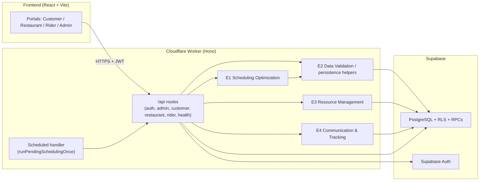
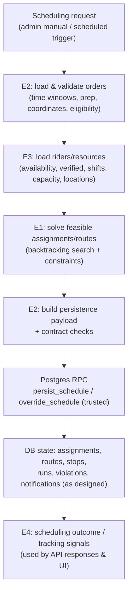
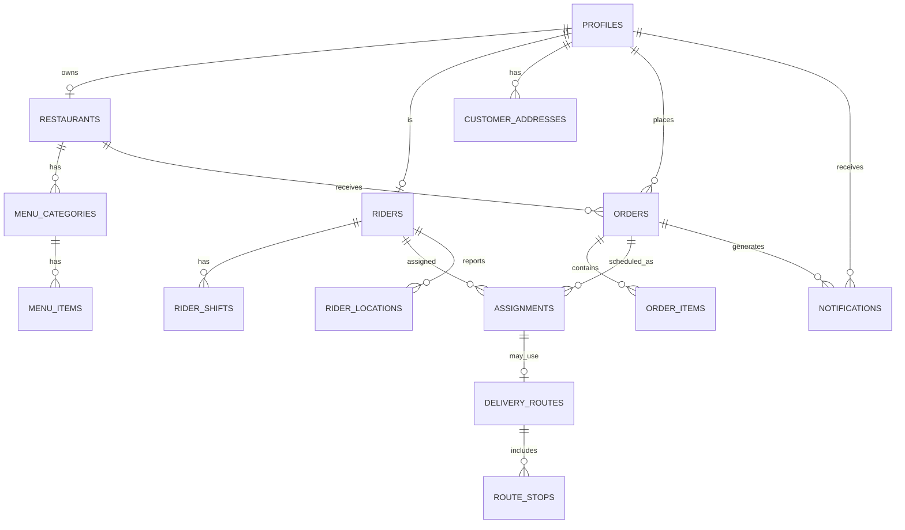

# RouteSync


RouteSync is an academic, constraint-based food delivery operations platform built around **four cooperating engines** (validation, scheduling optimization, resource management, communication/tracking). It combines a React + Vite frontend, a Hono API running on Cloudflare Workers (with static asset hosting), and Supabase (PostgreSQL + Auth + RLS) for trusted, role-scoped workflows.

> This repository is prepared for academic demonstration. Some advanced live verification remains incomplete due to an intermittent `persist_schedule` RPC timeout (see **Known limitations**).

---

## Project overview and problem statement

Food delivery coordination requires consistent handling of restaurant availability, delivery windows, rider capacity/shifts, route feasibility, and auditable order state changes. RouteSync models this as a **constraint-first** system:

- Orders move through explicit lifecycle states with server-side validation and history.
- Scheduling produces feasible rider assignments/routes under hard constraints (time windows, capacity, shifts, coordinates, ordering constraints enforced in SQL/RPCs).
- The UI is split into four portals (Customer, Restaurant, Rider/Delivery Partner, Admin) with role-based access enforced by Supabase Auth + RLS and trusted server endpoints.

---

## Technology stack

**Frontend**
- React 19, React Router 7, Vite 7
- Tailwind CSS (via `@tailwindcss/vite`) + custom UI components
- Supabase JS client (`@supabase/supabase-js`)

**Backend (Worker/API)**
- Cloudflare Workers + Hono (`backend/wrangler.jsonc`, `backend/src/index.js`)
- Supabase server clients (user-scoped by default; privileged client used only in explicitly authorized server flows)
- Four engine modules under `backend/src/engines/*`

**Database & security**
- Supabase PostgreSQL with migrations in `supabase/migrations/`
- Row Level Security (RLS) enabled across application tables, least-privilege grants
- Trusted RPCs/functions for lifecycle and scheduling persistence (browser roles cannot directly write protected rows)

**Tooling**
- Node.js **>= 22.12.0** (verified in this repo on Node 25.x in development)
- GitHub Actions CI (`.github/workflows/ci.yml`) for install, local tests, production build

---

## Four user portals and capabilities

| Portal | Route(s) (high level) | Intended capabilities (as implemented) |
|---|---|---|
| Customer | `/customer/*`, checkout/tracking flows | Browse restaurants/menus, cart/checkout, place orders, view orders/tracking, manage profile/addresses/notifications (role-gated). |
| Restaurant | `/restaurant/*` | Restaurant operations views (dashboard/menu/profile/kitchen-related screens), update order preparation flow via trusted APIs/RPCs where applicable. |
| Rider / Delivery Partner | `/delivery-partner/*` (alias `/delivery` redirects) | View assignments/route/history/shifts/profile, update availability/location-related flows through trusted server endpoints where applicable. |
| Admin | `/admin/*` | Dispatch and scheduling tools, order/restaurant/rider oversight, live tracking views, rescheduling/violations/audit-oriented screens (role-gated). |

Roles are resolved from trusted profile data (`profiles.role`) after Supabase Auth sign-in; client metadata is not trusted for authorization.

---

## Four-engine architecture (Mermaid)





---

## Database architecture and ER diagram (high level)

Migrations define the schema under `supabase/migrations/` (enums, core tables, operations tables, functions/triggers, RLS, grants, lifecycle/scheduling/phase migrations). Core domains include:

- Identity/profile: `profiles`, `riders`, `rider_shifts`
- Restaurants/menu: `restaurants`, `menu_categories`, `menu_items`
- Customers: `customer_addresses`
- Orders: `orders`, `order_items`
- Fulfillment/scheduling: `assignments`, `delivery_routes`, `route_stops`, `rider_locations`, `scheduling_runs`, `constraint_violations`
- Messaging/audit: `notifications`, `audit_logs`



For exact columns, constraints, and policies, refer to SQL files in `supabase/migrations/` and `docs/PHASE3_DATABASE_AUTH.md`, `docs/PHASE5_ORDER_LIFECYCLE.md`.

---

## Constraint-based scheduling algorithm and hard constraints

- **E1 (optimization)** performs a constraint-driven search (backtracking with pruning/limits as implemented) over feasible rider/route assignments for eligible orders.
- **E2 (validation)** filters ineligible orders (status/window/readiness/coordinates/restaurant validity and related checks) before solving and validates persistence contracts.
- **E3 (resources)** loads rider eligibility inputs (active/verified/available, location presence where required, usable shift windows, current load vs capacity).
- **Persistence** is performed through trusted Postgres RPCs (e.g. scheduling persistence/override paths) designed to be atomic and enforce invariants server-side.

**Hard constraints (enforced in application logic and/or database/RPCs, as implemented):** role/authorization checks, order eligibility by status and timing, valid coordinates and addresses for routing/stops, rider verification/availability/shift coverage, rider concurrency/capacity limits, idempotency/duplicate-assignment protections in flows, and route/assignment consistency checks in SQL (see migrations such as constraint/scheduling and phase 7/8 migrations). Exact behavior is defined in `backend/src/engines/*`, `backend/src/lib/scheduling*.js`, and `supabase/migrations/*`.

---

## Order lifecycle (summary)

Order state transitions are handled through trusted server-side flows (see `backend/src/lib/orderLifecycle.js`, `docs/PHASE5_ORDER_LIFECYCLE.md`). The system records lifecycle/history and scheduling-related effects (assignments, routes/stops updates, notifications) according to implemented RPCs and triggers/migrations. Use the in-app portals and API routes under `/api/*` as the operational interface.

---

## API overview (implemented routes)

API is mounted under `/api` (see `backend/src/routes/*`, `backend/src/app.js`). High-level groups include:

- `GET /api/health` — worker/runtime + Supabase connectivity probe (returns 503 with safe reasons when misconfigured; no secrets leaked).
- `/api/auth/*` — authentication-related endpoints (see `auth.routes.js`).
- `/api/admin/*` — admin operations (dispatch/scheduling, orders, tracking views, etc.).
- `/api/customer/*` — customer-facing operations.
- `/api/restaurant/*` — restaurant operations.
- `/api/rider/*` — rider/delivery partner operations.

Exact request/response shapes are defined in route handlers and shared helpers in `backend/src/lib/*`.

---

## Local installation and configuration

### Prerequisites

- Node.js **>= 22.12.0**
- npm (lockfiles committed)

### Install

```powershell
cd C:\Users\Nikhil\Desktop\RouteSync
npm run install:all
```

### Configure environment files (do not commit real secrets)

Create/edit local files (ignored by Git):

| File | Variables (placeholders only) |
|---|---|
| `frontend/.env.local` | `VITE_SUPABASE_URL`, `VITE_SUPABASE_PUBLISHABLE_KEY` |
| `backend/.dev.vars` | `SUPABASE_URL`, `SUPABASE_PUBLISHABLE_KEY`, `SUPABASE_SECRET_KEY` |

Templates: `frontend/.env.local.example`, `backend/.dev.vars.example`, `.env.example`.

Optional:
- `CORS_ORIGIN` (Worker) — comma-separated origins (default includes `http://localhost:5173`)
- `DEMO_*` variables only when running demo seed/remote tests as documented in `tests/README.md` and `docs/PHASE3_DATABASE_AUTH.md`

### Run (development)

```powershell
npm run dev
```

Or separately:

```powershell
npm run dev:worker
npm run dev:frontend
```

Typical URLs: Worker/API `http://localhost:8787`, Vite `http://localhost:5173` (with proxy to API as configured).

### Database migrations and demo seed

Apply migrations manually in order to your Supabase project per `docs/PHASE3_DATABASE_AUTH.md`. Demo seed (`npm run seed:demo`) is development-only and requires explicit env configuration; follow documentation carefully.

---

## Cloudflare deployment (summary)

After building and validating locally:

```powershell
npm run build
npx wrangler login
npm run worker:deploy
npm run worker:tail
```

Set Worker secrets from `backend/` (names only, values set securely):

- `SUPABASE_URL`
- `SUPABASE_PUBLISHABLE_KEY`
- `SUPABASE_SECRET_KEY`

Use `wrangler secret put <NAME>`. Do not place the service role/secret key in frontend env or in Git.

---

## Verified testing results (from repository evidence)

- **Local automated tests:** `npm run test:local` — **105/105 passed** (Node test runner suite as of last verified run in this repo). CI runs the same command.
- **Production build:** `npm run build` — **passes** (frontend Vite build). CI runs the same command.
- **Remote/auth security suite (`tests/remote-auth.test.mjs`):** in documented runs, **16/16 executed tests passed** with **1 optional registration test skipped** when prerequisites/configuration were not applied (see `tests/README.md`). This requires a configured remote environment and is not run in default CI.
- **Scheduling/live notes (evidence-based):** isolated scheduling persistence and database readback have been demonstrated in controlled diagnostics; assignment cancellation, route cancellation, and rider capacity release behaviors have been verified in related flows during development. Full advanced live verification is **not complete** (see Known limitations).

---

## Known limitations

- **Intermittent `persist_schedule` RPC timeout (unresolved reliability limitation):** under some conditions, persistence via `persist_schedule` can time out (observed in diagnostics). Reconciliation steps may be required after timeouts; do **not** assume a timed-out client call means nothing committed without checking database state. Root cause remains under investigation/documented as a limitation.
- **Advanced live verification incomplete:** end-to-end live verification across all portals and scheduled/cron-driven paths is not fully certified in this repository state.
- **Academic project scope:** not hardened for production SLAs, incident response, or full observability beyond basic logs/health checks.
- **Screenshots:** placeholder section below is intended for real screenshots added later; no fake/broken image links are included.

---

## Screenshots (add later)

_Place real screenshots in `docs/screenshots/` (or similar) and link them here once captured. Do not add fabricated images._

| Area | Screenshot |
|---|---|
| Landing / marketing | _(to be added)_ |
| Customer portal | _(to be added)_ |
| Restaurant portal | _(to be added)_ |
| Rider portal | _(to be added)_ |
| Admin dispatch | _(to be added)_ |

---

## Documentation index

- `docs/PROJECT_PLAN.md` — project plan and phases
- `docs/PHASE3_DATABASE_AUTH.md` — database/auth setup, migrations, seed, verification
- `docs/PHASE5_ORDER_LIFECYCLE.md` — order lifecycle notes
- `docs/PHASE5_FINAL_REPORT.md` — phase report (if present)
- `tests/README.md` — test running instructions (local vs remote)

---

## Academic team and project information

- **Project:** RouteSync — Smart Constraint-Based Food Delivery Management System
- **Institution:** KLE Technological University, Dr. M. S. Sheshgiri Campus
- **Department:** Computer Science and Engineering
- **Team:** 05
- **Guide:** Prof. Tabassum
- **Team members:**
  - Nikhita Rajesh Patil — 02FE24BCS005 — Smart Scheduling & Optimization
  - Nikhil Vijapur — 02FE24BCS043 — Data & Validation
  - Sakshi Magadum — 02FE24BCS159 — Resource Management
  - Ritvik Shinde — 02FE24BCS083 — Communication & Tracking
- **Repository:** `https://github.com/Nikhil306-ctrl/RouteSync`

---

## Security notes (summary)

- Never commit `.env`, `backend/.dev.vars`, private keys, or auth session exports.
- Browser clients use publishable keys only; `SUPABASE_SECRET_KEY` is server/CLI-only.
- RLS and trusted RPCs are the intended enforcement layers; do not bypass them in clients.

If you believe a secret was exposed, rotate it immediately in the Supabase/dashboard provider and update local/secret stores—do not commit the new value.
